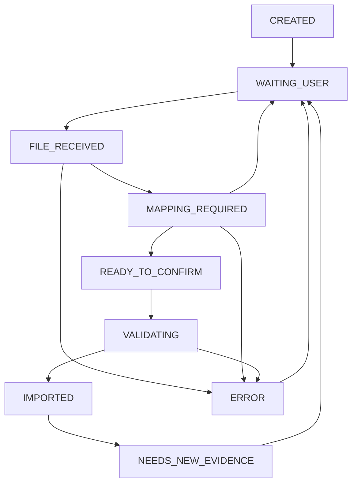
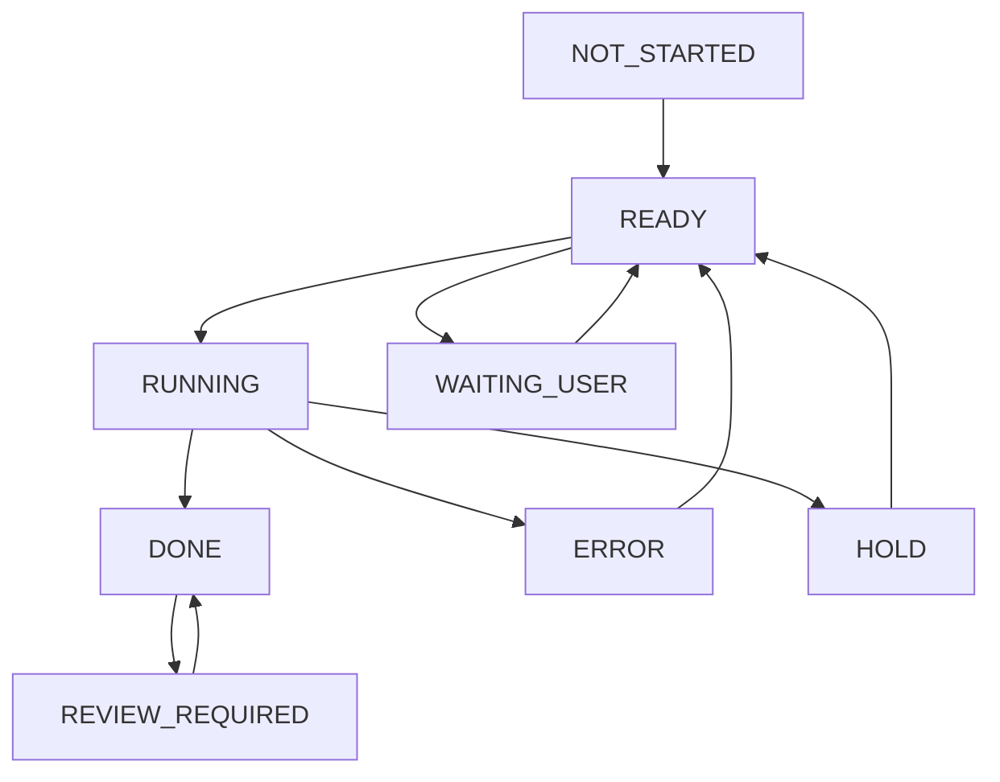

# WORKFLOW STATE MACHINE & OBSERVABILITY CONTRACT — V1.3

## 1. Ba lớp trạng thái phải tách rời

1. `WorkflowStep` — công việc ở bước này là chưa bắt đầu, đang chạy, chờ người dùng, chờ review, bị chặn, hoàn thành hay lỗi.
2. `ResearchRequest/ImportBatch` — yêu cầu đã tạo, chờ upload, có file, cần mapping, đang validate, đã import, bị từ chối.
3. `SeoGateDecision` — đánh giá `PASS/HOLD/REVIEW/OUT_OF_SCOPE` theo bằng chứng hiện có.

Một file đã `IMPORTED` KHÔNG làm `F5_SERP=PASS` và KHÔNG cho phép `BRIEF=APPROVED`. Tương tự `Topic Map=GENERATED` KHÔNG có nghĩa AI đã chứng minh nhu cầu tìm kiếm bằng số liệu Semrush.

## 2. State transition: ResearchRequest



**Backend guards:**

- `WAITING_USER → FILE_RECEIVED`: chỉ khi có file thực đã nhận, có owner request ID.
- `FILE_RECEIVED → MAPPING_REQUIRED`: parser đã đọc header/sheet, chưa đổi business data.
- `MAPPING_REQUIRED → READY_TO_CONFIRM`: mapping hợp lệ; required fields thỏa quy tắc report, cột trống được gắn nullable nếu policy cho phép.
- `READY_TO_CONFIRM → VALIDATING`: click Confirm từ user và lưu decision ID.
- `VALIDATING → IMPORTED`: validation hoàn thành, audit raw file/provenance, dữ liệu đã commit.
- `ERROR`: error code + next action; request có thể retry nhưng import cũ vẫn bất biến.

## 3. State transition: WorkflowStep / Job



Trạng thái `WAITING_USER` không có heartbeat worker. Khi người dùng đang thao tác trên Semrush bên ngoài, backend không được hiển thị `RUNNING` vì app không làm gì.

## 4. Dữ liệu bắt buộc ở WorkflowRun

```json
{
  "run_id": "ULID",
  "project_id": "UUID",
  "step_id": "SEMRUSH_IMPORT",
  "status": "WAITING_USER",
  "started_at": "2026-11-20T03:00:00Z",
  "updated_at": "2026-11-20T03:00:00Z",
  "actor": "USER",
  "task_name": "Xuất báo cáo Keyword Overview ngoài ứng dụng",
  "current_operation": null,
  "progress": {"current": null, "total": null, "unit": null},
  "blockers": [
    {"code": "SEMRUSH_EXPORT_NOT_UPLOADED", "message_vi": "Chưa nhận file được yêu cầu", "related_request_id": "RQ-001"}
  ],
  "next_action": {
    "label_vi": "Xem hướng dẫn Semrush",
    "route": "/projects/{project_id}/research-requests/RQ-001",
    "required_actor": "USER"
  },
  "evidence_refs": [],
  "last_error": null,
  "version": 1
}
```

Nếu `progress.current/total` là null thì không được vẽ thanh phần trăm; chỉ hiển thị trạng thái + việc đang thực hiện. Ngược lại import 240/1200 rows là một metric có thể hiển thị.

## 5. Audit events

`Event` gồm `event_id`, `run_id`, `project_id`, `step_id`, `event_type`, `actor`, `timestamp`, `details`, `source_ref_ids`, `error_code`, `idempotency_key`. `details` không lưu raw API key hoặc file bí mật.

| Event type | Nguồn | Ghi vào Timeline |
|---|---|---|
| `PROJECT_SAVED` | USER | Dự án được lưu |
| `TOPIC_MAP_REQUESTED` | USER | Người dùng yêu cầu AI nghiên cứu |
| `TOPIC_MAP_GENERATED` | WORKER | AI tạo ứng viên, chưa được duyệt |
| `RESEARCH_REQUEST_CREATED` | WORKER/USER | Phiếu RQ mới + loại report + seed |
| `WAITING_EXTERNAL_SEMRUSH` | SYSTEM | Chờ thao tác ngoài ứng dụng |
| `UPLOAD_STARTED` | USER | Đang nhận file, chưa import |
| `FILE_PARSED` | SYSTEM | Có header, số dòng, filename, checksum |
| `COLUMN_MAPPING_CONFIRMED` | USER | Ánh xạ được người dùng xác nhận |
| `IMPORT_VALIDATION_STARTED` | WORKER | Đang kiểm tra dữ liệu |
| `IMPORT_COMMITTED` | SYSTEM | Đã lưu observations bất biến |
| `SEO_GATE_EVALUATED` | WORKER | F1–F7 đã chạy, PASS/HOLD/REVIEW... |
| `EVIDENCE_GAP_IDENTIFIED` | WORKER | Thiếu dữ liệu gì và phải lấy ở đâu |
| `APPROVAL_RECORDED` | USER | Duyệt/bác bỏ thay đổi, version |
| `SERP_EVIDENCE_ADDED` | USER | Đã nhập URL & bối cảnh quan sát |
| `EXPORT_GENERATED` | WORKER | File local đã được tạo thành công |
| `RUN_FAILED` | SYSTEM | Mã lỗi và action Retry |

## 6. Thứ tự hiển thị blocker/next-action

Ưu tiên theo tính phụ thuộc:

1. `PROJECT_MISSING` / `TOPIC_SCOPE_INVALID`.
2. `REQUIRED_APPROVAL_PENDING` nếu ảnh hưởng request/plan đang chạy.
3. `FILE_MAPPING_REQUIRED` nếu đã chọn file.
4. `FILE_UPLOAD_MISSING` cho request đang mở.
5. `METRIC_INVALID_OR_MISSING` nếu một quyết định dựa vào metrics đó.
6. `SERP_EVIDENCE_MISSING` cho quyết định page type.
7. `ARTICLE_MAPPING_REVIEW_PENDING`.
8. `BRIEF_QA_HOLD`.

Cùng lúc có thể có nhiều blocker ở panel phải, nhưng CTA chính trên Hero chỉ chọn một mục ưu tiên. Blocker nào không chặn việc khác thì cho phép làm song song (ví dụ nhiều request Semrush độc lập).

## 7. Async operations & UI feedback

- Trước khi gọi server: status=RUNNING và hiển thị tên operation thực.
- API trả job id cho task dài; frontend subscribe SSE `/api/v1/runs/{id}/events` hoặc poll `/api/v1/runs/{id}`.
- Không dùng progress percentage đoán từ thời gian; chỉ dùng processed rows / known total, bytes / total bytes, hoặc completed substeps / known substeps.
- Khi job thành công: status=DONE, audit, success toast, mở step kế tiếp **nếu đủ điều kiện**.
- Khi job lỗi: status=ERROR, error message tiếng Việt, source request/file, CTA `Thử lại` hoặc `Tải error log`.
- Khi đóng trình duyệt: data trong SQLite; mở lại fetch Run/Request states và tiếp tục; không tự hủy request `WAITING_USER`.
- Khi user nhấn Pause: chỉ pause worker task cancellable, không phá import transaction.
- Không đổi trạng thái bằng local-only frontend logic trong sản phẩm thật. Local-only demo `prototype/app.js` là mô phỏng UI hợp lệ, không thay backend rule engine.

## 8. User acceptance journeys

- **Journey A:** tạo Project mới không có P01 → nhập taxonomy + keyword → tạo request → mở UI Semrush bên ngoài → upload → preview → map → confirm → verify state.
- **Journey B:** file thiếu KD → hiển thị `HOLD`, reason `KD_MISSING`, CTA `Tạo yêu cầu bổ sung KD`, không chuyển sang brief chính thức.
- **Journey C:** nhập xlsx có nhiều tab → chọn tab; lưu mapping; xử lý 9.900 đúng theo vi-VN; không suy đoán `9,900` khi mơ hồ.
- **Journey D:** approval thay primary keyword → chờ duyệt; reject không thay source; approve tạo version mới; dashboard phản ánh ngay.
- **Journey E:** user đóng ứng dụng trong lúc chờ xuất file từ Semrush → quay lại sau một ngày → phiếu vẫn ở `WAITING_USER` và hướng dẫn còn nguyên.
- **Journey F:** ghi nhận SERP 3 URL → trạng thái `REVIEW/HOLD` tùy policy, không nói “đã xem top 10”.


## V1.4 Source Intake State Extension
```
NO_SOURCE_FILE → SOURCE_PARSING → SOURCE_PREVIEW
SOURCE_PREVIEW → SOURCE_PARTIAL (only Topic Pillar or Keywords)
SOURCE_PREVIEW → SOURCE_READY (both tables)
SOURCE_READY → SOURCE_APPLIED_DRAFT → PROJECT_SAVED
SOURCE_PARSING → SOURCE_ERROR (unsupported/broken file)
```
Source intake is independent of the Semrush workflow statuses. `SOURCE_GROUP` from the workbook is **not** `VALIDATED_DEMAND`. For production preserve import snapshots, diffs and immutable decision logs.
